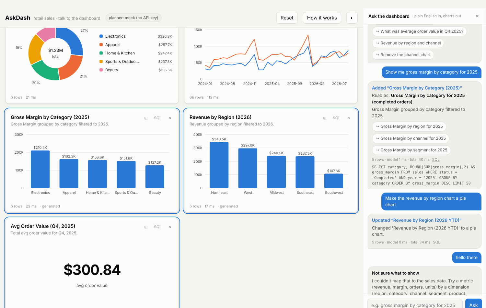

# AskDash — talk to your dashboard

An executive sales dashboard you change by typing plain English.

> "Show me gross margin by category for 2025" · "Make the region chart a pie" · "What was average order value in Q4?"

Each request goes to an LLM with the dashboard's current state and a curated schema. The model returns one
*action* (add / replace / remove / answer) with SQL and a chart spec. The SQL is validated by a multi-layer
safety guard, executed against a read-only SQLite database, and rendered as a chart. The model never
touches the data; it only writes queries that the application decides whether to run.

This is a public, synthetic-data re-creation of a system built to let non-technical executives explore a
reporting database without filing a ticket for every new view.



## Why it's built this way

| Problem | Decision |
|---|---|
| LLM-written SQL is wrong more often when it has to join | The model sees a single **flattened `sales` view** with revenue, cost and margin precomputed. Base tables exist but are de-emphasized in the prompt. |
| "Make *that* a line chart" needs context | The browser sends the **current panels (title, SQL, chart spec)** with every request, so the model can target a `panel_id`. The server is stateless. |
| Model output can't be trusted | Four independent layers: static checks (single `SELECT`, deny-list) → SQLite **authorizer callback** that refuses anything but reads of allow-listed tables → `mode=ro` connection with 5s timeout and 500-row cap → schema allow-list. See `backend/sql_guard.py`. |
| Public demo + paid API = abuse risk | Per-IP rate limit, daily request budget, 500-char request cap, and a spend cap set on the API console. |
| SQL errors happen | The error is fed back to the model once for a self-correction attempt (`core._retry_with_error`). |
| Execs can't tell what a chart *means* without context | Every answer comes back with **`interpreted_as`** (the precise question the model actually answered) and 2-3 **`suggestions`** (concrete follow-ups). The chat pane shows the whole conversation, so the numbers on screen always have a provenance trail. |
| Vague questions ("tell me about our products") | The model is told to pick the most useful single view, state how it read the question, and offer the alternative readings as one-click chips. Prose answers are surfaced as messages, never errors. |
| Must work without a key | A rule-based `MockPlanner` handles common requests so the demo runs end to end with zero credentials. |
| Zero-dependency front end | Charts are hand-rendered SVG (line, bar, horizontal bar, stacked bar, donut, table, KPI) with tooltips, light/dark themes and a validated colorblind-safe palette. No chart library. |

## Architecture

```
browser ──POST /api/ask {request, panels[], history[]}──▶ FastAPI / stdlib server
                                                            │
                                                            ├─ llm.py       build prompt (schema + panels + request) → Claude → JSON plan
                                                            ├─ sql_guard.py validate → authorizer → read-only SQLite (timeout, row cap)
                                                            └─ core.py      assemble panel {title, sql, chart, data} ◀──
                                                            
◀──────────────── {plan, panel: {data: {columns, rows}}} ───┘
browser renders SVG chart; stores layout in localStorage
```

Files:

```
backend/
  generate_data.py   synthetic retail dataset (seeded) → SQLite + `sales` view
  sql_guard.py       validation, SQLite authorizer, read-only execution
  llm.py             system prompt, Claude planner, mock planner, plan parsing
  core.py            framework-agnostic app logic, rate limiting, default panels
  app.py             FastAPI wrapper (production)
  devserver.py       stdlib HTTP wrapper (no dependencies)
frontend/index.html  single-file dashboard: SVG charts, chat pane with interpretation + suggestions, SQL viewer
tests/               unit + integration tests (unittest; no external deps)
```

## Run it

```bash
git clone <this repo> && cd askdash
python backend/generate_data.py          # builds data/retail.db (~20k orders, 2024-01 → 2026-09)

# Option A: zero dependencies
python -m backend.devserver              # http://localhost:8000  (mock planner)

# Option B: FastAPI
pip install -r requirements.txt
uvicorn backend.app:app --reload         # http://localhost:8000, API docs at /api/docs

# With Claude:
export ANTHROPIC_API_KEY=sk-ant-...
python -m backend.devserver              # header pill turns green: "LLM: claude-…"
```

Tests: `python -m unittest tests.test_askdash` (or `pytest`).

## Deploy (free tier)

**Render** — push to GitHub, "New Web Service", pick the repo. `render.yaml` sets the build/start commands.
Add `ANTHROPIC_API_KEY` as a secret environment variable. The database is rebuilt at build time.

**Docker** (Fly.io, Railway, Hugging Face Spaces):
```bash
docker build -t askdash . && docker run -p 8000:8000 -e ANTHROPIC_API_KEY=... askdash
```

Set a monthly spend limit on the Anthropic console before publishing the URL. With `claude-sonnet-5-5`
a request costs well under a cent; the default `ASKDASH_DAILY_CAP=500` bounds daily spend to a few dollars
worst case.

## Configuration

| Env var | Default | Purpose |
|---|---|---|
| `ANTHROPIC_API_KEY` | — | Enables the live planner. Unset → mock planner. |
| `ASKDASH_MODEL` | `claude-sonnet-5-5` | Model id. |
| `ASKDASH_DB` | `data/retail.db` | SQLite path. |
| `ASKDASH_RATE_PER_MIN` | `10` | Per-client request limit. |
| `ASKDASH_DAILY_CAP` | `500` | Global daily model-call budget. |

## Things I'd do next

- Enforce the JSON contract with the API's structured-output / JSON-schema option instead of prompt instructions.
- Streaming the model's explanation while the SQL runs.
- Semantic caching: identical requests against an unchanged dashboard shouldn't hit the model twice.
- Evaluation harness: a set of (request, expected SQL result) pairs to measure planner accuracy across models and prompt changes.
- Swap SQLite for Postgres/BigQuery with the same guard pattern (read-only role + statement timeout + `EXPLAIN` cost check).
